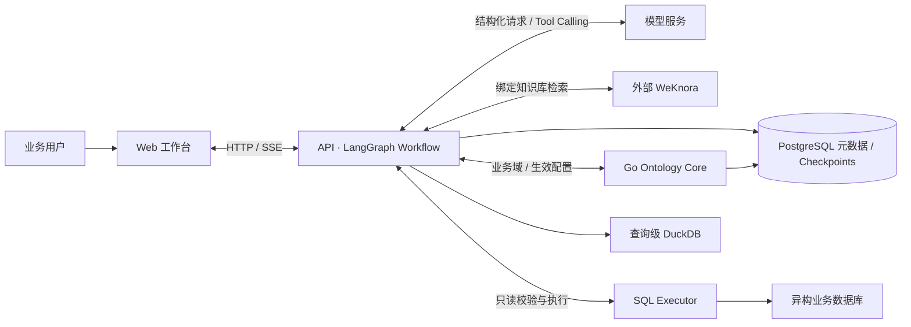
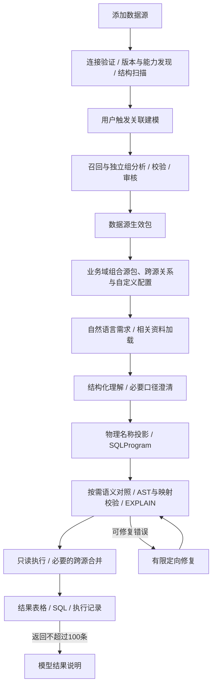

# Semora

### 本体驱动的智能数据分析平台 · Ontology-grounded NL2SQL

Semora 将自然语言需求、数据库元数据、领域本体与可执行 SQL 连接为完整的数据分析工作流。通过 **Schema Intelligence、Agentic Orchestration、语义约束与确定性执行校验**，完成从异构数据源接入、表间关联发现，到业务口径澄清、跨源查询与结果交付的闭环。

核心架构采用 **Python + Go + TypeScript**：LangGraph 管理查询状态与持久化恢复，Ontology Core 管理业务域语义配置，SQLGlot 负责 SQL AST 分析与方言转换，独立 Executor 承载只读数据库访问。业务语义来自运行时结构、注释、本体和知识库绑定，核心流程保持行业无关。

## 核心能力

| 能力域 | 技术实现 | 解决的问题 |
|---|---|---|
| 异构数据接入 | Native Protocol / JDBC、数据库版本发现、结构快照、约束与索引采集、能力探测 | 将不同数据库组织为统一的元数据输入 |
| 智能关联发现 | 精简 Schema、关键词召回、模型分组、有界工具探索、数据取证、研究去重 | 在全库目录中发现有业务含义的单源与跨源关系 |
| 本体语义层 | 对象与属性映射、复合键、关联条件、业务域、数据源包引用、内容哈希快照 | 将物理结构组织成可复用的查询语义 |
| 自然语言分析 | 结构化需求契约、最小必要对象选择、分支澄清、确认事实持久化 | 将口语化需求转为明确的查询目标与统计口径 |
| SQL 原生执行 | SQLProgram、AST 校验、参数绑定、方言适配、EXPLAIN、有限定向修复 | 将模型输出转化为受约束、可验证的数据库操作 |
| 跨源数据计算 | 顺序 source/local 步骤、完整键元组传递、查询级内存 DuckDB | 在不同数据源之间组织过滤、关联与结果合并 |
| 上下文工程 | 按需选表、物理名称投影、重复定义合并、列式 JSON 编码、请求预算 | 减少模型输入冗余，保留已选对象的字段与业务语义 |
| 任务可观测性 | SSE 增量事件、Run/Trace 标识、模型请求指标、检查点、取消与续跑 | 定位耗时、协议异常、技术未完成和恢复位置 |

### Schema Intelligence：从结构采集到关联语义

新增数据源后，系统主动获取版本、能力与结构信息；**关联建模由用户显式触发**，不会在扫描完成后自动发起全库模型分析。

关联发现采用“**结构精简 → 关键词提取 → 检索召回 → 分组整理 → 独立组分析 → 取证与审核 → 生效包更新**”的分阶段管线。关键词提取每批最多 10 张表，提取与检索共用实际表名、字段名及注释的归一化规则；单表命中词不进入后续关联分析。模型负责解释语义与映射，程序负责资料组织、预算约束、事实校验、去重和持久化。

研究过程支持共享并发限额、工作记录与检查点恢复；声明外键作为结构证据进入建模。关系支持复合字段、多种基数及附加条件，管理页区分已生效、待审核、已停用；待审核关系中，基数尚为 `unknown` 的提议需要补齐有效定义后才能确认。

### Ontology-grounded Query：从需求契约到物理 SQL

需求分析先选择相关对象，再读取已选表的字段定义与关系，资料不足时通过工具补充。当前是**表级按需加载**，选中的表仍提供完整本体字段，而非字段级截断。

SQL 生成、语义对照和修复阶段使用独立的物理名称投影：将内部对象、属性与关系引用转换为真实表列及完整条件，保留主键、类型、注释、枚举和数据源归属。原始本体与内部校验结构保持不变；SQL 字面量和业务编码不会被字符串替换。

模型提交 `SQLProgram`，明确每步引擎、SQL、参数、依赖和输出契约。程序完成只读 AST 校验、作用域与映射检查、统计粒度检查、方言转换及数据库预检；可修复 SQL 错误进入有预算的定向修复，认证、权限和连接故障保留其原始分类。

## 系统架构



常驻运行单元为 **Web、API、Ontology、Executor、PostgreSQL**。DuckDB 内嵌于 API 的查询执行过程；模型与 WeKnora 为外部集成，不额外启动知识解析服务。数据库连接凭据由 Executor 加密持久化，模型上下文不包含连接密码。

| 技术层 | 组件 | 主要职责 |
|---|---|---|
| Web Console | Vue 3、TypeScript、Vite、TDesign | 数据源、业务域、关联抽屉、知识库绑定与查询工作台 |
| API / Agent Runtime | FastAPI、Pydantic v2、LangGraph、LangChain | 结构化契约、受限工具调用、状态持久化与流式交付 |
| Ontology Core | Go、pgx、PostgreSQL | 本体校验、源包组合、跨源关系管理、生效快照与关系寻路 |
| SQL Processing | SQLGlot | PostgreSQL 基准 SQL 解析、AST 检查、目标方言转换与参数绑定 |
| SQL Executor | Python、psycopg、PyMySQL、Java JDBC Worker | 结构扫描、查询能力探测、只读访问、结果限制与类型保真 |
| Local Compute | DuckDB | 查询级中间结果关联、聚合与跨源合并 |
| Knowledge Integration | WeKnora API | 业务知识检索、Wiki 阅读与必要的原文回溯 |
| Delivery | Docker Compose、可选 Cython 构建 | 服务隔离、一次性迁移、镜像构建与编译交付 |

## 数据与查询生命周期



完整扫描成功后才提交结构变更；连接失败或扫描中断不会把未读取的表当作删除。结构扫描与关系重分析解耦，关联分析失败保留上一份生效结果。业务域通过数据源包引用与域内跨源配置组成生效定义；新查询读取当前快照，进行中的查询保持已绑定快照。

## 快速启动

本地运行需要 Docker Engine / Docker Desktop 与 Docker Compose v2。开发构建工具链见各服务 Dockerfile；无需在宿主机安装 Java 或 Go 才能启动容器。

```sh
cp .env.example .env
# 按实际环境调整 .env；模型也可启动后在设置页面配置。
docker compose -f docker-compose.yml -f deploy/compose.mvp.yml up -d --build web
```

Windows Docker Desktop 可使用 `./scripts/start-mvp.ps1`，停止和更新脚本位于同一目录。

- 工作台：<http://127.0.0.1:5173>
- API 文档：<http://127.0.0.1:8000/docs>
- API 健康检查：<http://127.0.0.1:8000/healthz>

`migrate`、`langgraph-migrate`、`ontology-migrate` 是一次性 schema 迁移任务，不是常驻业务服务。默认 `SEMORA_DEMO_SEED=false`，业务数据源与知识库由交付后的使用方配置。

首次使用：**配置模型 → 添加数据源并完成扫描 → 点击更新关联关系 → 建立业务域并绑定数据源 → 按需绑定知识库 → 提交查询**。数据源连接参数创建后不可修改；需要更换连接时新建数据源，现有条目支持重命名。

持久化状态包含 PostgreSQL 元数据、`executor-config` 加密连接配置卷及 `relationship-checkpoints` 研究检查点卷。迁移已有环境前保留数据库与配置卷；当前元数据迁移文件位于 `deploy/postgres/migrations`，已演进至 `016-relationship-keyword-work.sql`。

## 数据库接入

| 接入方式 | 产品入口 |
|---|---|
| PostgreSQL 原生协议 | PostgreSQL |
| MySQL 原生协议 | MySQL、GoldenDB |
| 内置 JDBC 驱动 | Oracle、SQL Server、OceanBase、Vastbase |
| 可配置 JDBC 驱动包 | 其他提供 JDBC 的数据库及特定厂商适配 |

接入能力按**连接、扫描、约束、方言、预检、实际查询**分别记录；产品入口或已打包驱动不代表所有服务器版本、兼容模式和复杂 SQL 已完成验证。自定义驱动需配置并验证方言与只读策略，详细契约见[多数据库接入](docs/MULTIDATABASE.md)。

## 开发与验证

```sh
python -m pip install -r services/api/requirements.txt -r services/executor/requirements.txt pytest
python -m pytest services/api/tests
python scripts/verify_dependency_policy.py

cd apps/web
npm ci
npm run build
npm run test:e2e
```

页面测试默认连接本地 `5173`，可通过 `SEMORA_WEB_URL` 指定隔离验收服务。Ontology 镜像构建执行 Go 测试，Executor 镜像构建编译 JDBC Worker。真实数据库测试使用独立实例并显式启用，不以业务数据源替代测试夹具。

CI 包含依赖固定版本策略、漏洞与许可证检查、CycloneDX SBOM 产出；可选编译交付将自有 Python 模块编译为原生扩展，并校验运行时载荷。

## 代码导航

| 入口 | 职责 |
|---|---|
| [`apps/web/src`](apps/web/src) | 管理控制台、查询交互与任务展示 |
| [`services/api/app/workflow.py`](services/api/app/workflow.py) | 查询生命周期与持久化状态编排 |
| [`services/api/app/datasource_modeling.py`](services/api/app/datasource_modeling.py) | 单源、跨源关联建模与包更新 |
| [`services/api/app/relationship_keywords.py`](services/api/app/relationship_keywords.py) | 关键词召回、分组与有界研究 |
| [`services/api/app/prepared_context.py`](services/api/app/prepared_context.py) | 对象选择、知识及结构上下文准备 |
| [`services/api/app/sql_model_context.py`](services/api/app/sql_model_context.py) | SQL 模型输入的物理名称投影 |
| [`services/api/app/query_context_wire.py`](services/api/app/query_context_wire.py) | 可还原的紧凑上下文编码 |
| [`services/api/app/sql_authoring.py`](services/api/app/sql_authoring.py) | SQL 生成、语义对照与定向修复 |
| [`services/api/app/sql_execution.py`](services/api/app/sql_execution.py) | 顺序校验、执行与依赖结果复用 |
| [`services/ontology`](services/ontology) | Go 本体服务 |
| [`services/executor`](services/executor) | 数据源适配、扫描与只读执行 |
| [`packages/contracts/python/semora_contracts`](packages/contracts/python/semora_contracts) | API、状态与 SQL 公共契约 |

## 技术文档

- [当前系统与 Agent 架构](docs/architecture/agentic-architecture.md)
- [SQL 查询链路与维护边界](docs/sql-generation-mvp.md)
- [关联发现、存储与恢复](docs/relationship-discovery.md)
- [查询上下文压缩与物理名称投影](docs/query-context-compaction.md)
- [多数据库适配与驱动契约](docs/MULTIDATABASE.md)
- [编译交付](docs/COMPILED_DELIVERY.md)
- [依赖治理](docs/DEPENDENCY_GOVERNANCE.md)
- [实施状态与历史记录](docs/IMPLEMENTATION_STATUS.md)

当前在线查询统一采用 SQLProgram / SQLGlot / Executor。Wren MDL 是可选导出格式，不是在线执行依赖；早期内置知识服务、独立 Semantic Planner、Reviewer Agent、审批与审计归档架构保留为历史记录，不代表当前部署。
