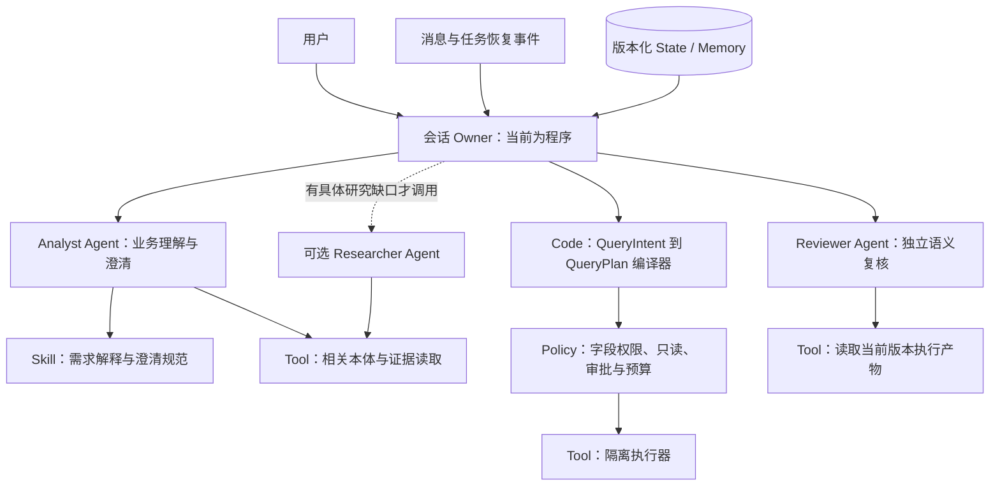
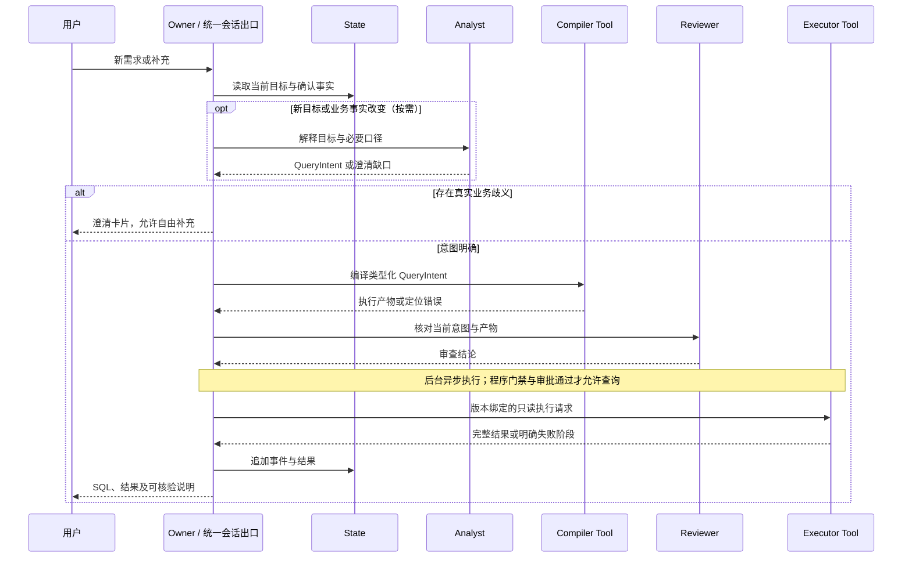
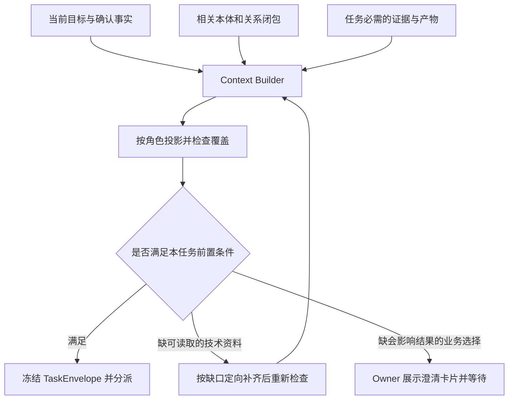
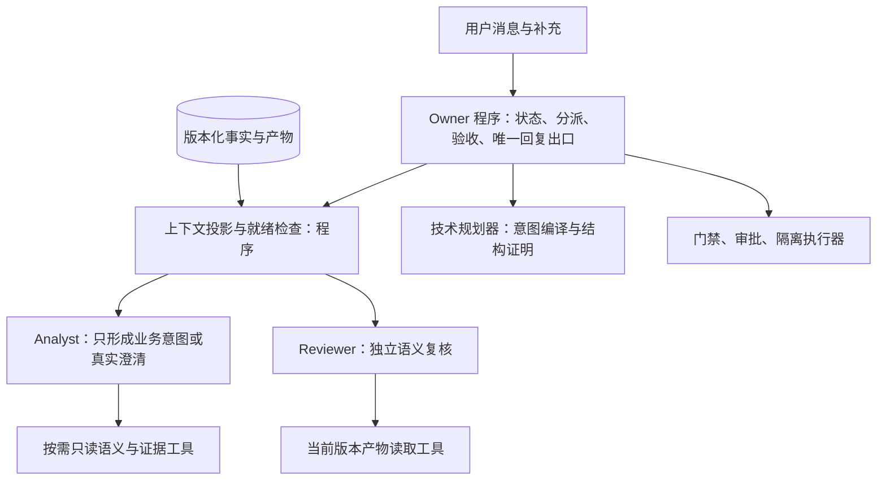

# Agent 职责、上下文与记忆交接设计

版本：0.4，2026-11-06。任务交接及默认协议的 QueryIntent 职责迁移已部署：Analyst 提交业务意图，程序生成技术执行方案。实际支持范围、明确限制和验收见 [业务意图与程序规划](query-intent-planning.md)。本文其余内容包含目标设计，不代表所有扩展契约与预算设计均已实现。新增能力复用现有服务，不增加常驻组件。

## 1. 架构结论

目标是稳定完成用户确认的查数任务。现阶段保留 Analyst、Reviewer 两个模型 Agent，现有会话 Owner 仍由程序承担。先把技术规划从 Analyst 下沉到编译器，避免增加模型角色后仍让它们共同手写复杂执行计划。复杂知识研究可在有独立研究目标时按需增加 Researcher。Owner 将来只有在需要自主协调多个独立业务目标时才升级为真正的 Main Agent。

## 2. 当前职责与目标职责

默认 `analyse()` 转入业务意图协议：准备相关上下文后，由 Analyst 判断业务歧义并提交 QueryIntent；程序确定关联键、拆步与预聚合，经过结构和局部编译检查后交独立 Reviewer。已移除前置重复的业务充分性推理。旧版由模型填写技术结构的协议只在显式关闭 AGENT_QUERY_INTENT 时保留兼容。

| 角色 | Goal | 输入 | 输出 | 调用 | Workspace |
| --- | --- | --- | --- | --- | --- |
| Analyst（Agent） | 将需求收敛为无歧义、可核验的业务查询意图 | 当前需求、确认事实、相关语义目录、证据 | QueryIntent 或具体澄清 | 新目标或业务事实改变时 | ISOLATED |
| Reviewer（Agent） | 独立判断意图、确认事实与执行产物的业务一致性 | 当前事实、意图、编译产物、程序检查摘要 | 通过或定位到语义字段的问题 | 新执行方案时，精确方案不重复做同类业务预检 | ISOLATED |
| Researcher（可选，暂不新增） | 解答一个需要多来源溯源的具体知识缺口 | 研究问题、知识库范围、证据预算 | 有来源的事实、冲突或无证据 | 复杂知识缺口时 | ISOLATED |

所有后台 Agent 不持有直接回复权，不持有数据库凭据，不直接执行查询，不修改其他角色内部状态，不互相指派。Owner 汇总任务结果并对用户交付；Reviewer 的独立结论仍是执行前置条件，Owner 不能绕过。

## 3. 非 Agent 能力

| 能力 | 类型 | 原因 |
| --- | --- | --- |
| 会话 Owner、任务分派、条件等待、预算和恢复 | Code / State | 当前下一步动作可由任务状态与结果确定，不需要每步再调用模型 |
| 数据源归属、关系路径合法性、跨源传键、唯一键、预聚合与 SQL 编译 | Code / Tool | 依据版本化本体与明确约束生成可验证执行结构 |
| 检索、读取知识页、读取字段定义 | Tool | 原子数据访问；简单查询不强制经过研究 Agent |
| 复杂研究方法和澄清规范 | Skill | 可复用工作方法 |
| 权限、只读、审批、超时和结果限制 | Policy | 不由模型自由决定 |
| 确认事实、意图版本、证据、审查问题和执行产物 | State / Memory | 版本绑定、独立恢复与审计 |
| 后台任务恢复事件 | Scheduler / Event | 不让 Agent 睡眠等待，不为此新增常驻服务 |

## 4. 总体结构（依赖图）



图表示调用依赖，不表示每条消息必须经过全部组件。返回值通过结果契约进入 Owner，不形成反向调用依赖。

## 5. Agent 协作依赖

Owner → Analyst；Owner → Reviewer；Owner → 可选 Researcher；各 Agent → 允许的只读工具。Analyst 不调用 Reviewer，Reviewer 不调用 Analyst；修订由 Owner 按定位到的具体问题指派。

## 6. 请求时序



## 7. 状态设计

State 是业务事实，不是 Workflow 节点。现有执行进度状态可以继续保留，但应额外明确以下事实：

| State | 进入条件 | 退出条件 | Goal |
| --- | --- | --- | --- |
| 未解决的业务问题 | 缺少会改变结果的业务定义 | 用户补充或有权威证据 | 确认口径 |
| 已确认意图版本 | 意图完整、无阻断歧义 | 用户修改或绑定版本变化 | 保留用户真实要求 |
| 当前产物已核验 | 编译、权限和独立复核通过 | 任一执行字段或权限变化 | 只执行核验版本 |
| 结果完整可交付 | 执行完整且核对无阻断问题 | 用户追加新目标 | 如实交付 |

状态由工具结果和程序检查更新，Agent 不能自行宣布权限通过、审批通过或执行完成。

## 8. 协作契约

Analyst：输入 task_id、goal、confirmed_facts、ontology_version、relevant_context；输出 `READY(QueryIntent)`、`NEED_USER_INPUT(具体问题)`、`BLOCKED(定位到的核心缺口)`；业务意图明确即停止，不设计物理执行字段，不以技术错误制造澄清。同步获得结果、前端异步展示进度，业务事实改变后可恢复。

Reviewer：输入 intent_hash、artifact_hash、confirmed_facts、程序检查摘要；输出通过或包含 path、evidence、acceptance 的问题。每类问题限定修订预算；不改目标、不改 SQL、不执行、不指派其他 Agent。修订只处理未解决的问题，禁止自行增加范围。

可选 Researcher：输入研究问题、绑定知识库、缺失事实及预算；输出带版本和来源的事实、证据冲突或未找到证据。达到研究目标或预算即停止；不决定用户口径，不生成执行计划，不直接回复用户。

## 9. 性能与恢复

- Fast Path：只补充卡片、查看结果、重试同一已确认产物，由程序处理状态与有效性，不重跑业务分析。
- Medium Path：明确的新查询，一次业务解释后程序编译，对新方案执行一次独立语义复核；不固定串联多个理解 Agent。
- Slow Path：真实语义缺口才研究或澄清；每个缺口有独立预算和具体产出。
- Async Path：执行、复杂研究和恢复通过已有后台任务及事件完成；前端持续可见状态。
- 不承诺尚未实测的调用次数与延迟分位数。Owner 初期不增加必经 LLM 调用，Researcher 不进入普通查询必经链路。

## 10. 依赖检查

循环依赖：无。多个会话回复 Owner：无。固定意图 Router：不新增。固定执行安全门禁：保留；它是确定性流程，不伪装成 Agent。编译器不能擅自决定含糊的多条关系路径；应将会改变含义的选择交给业务澄清。

## 11. 反 Workflow/DAG 审查与实施顺序

| 检查 | 结论 |
| --- | --- |
| 每个节点变为 Agent | 不采用；编译、执行、门禁保持程序 |
| 每条消息调用全部 Agent | 不采用；按当前事实与产物失效范围调用 |
| Agent 承担硬规则 | 将技术规划规则下沉，权限仍由程序控制 |
| Analyst 和 Reviewer 互相无限返工 | Owner 管理问题清单和预算，不允许角色互调 |
| 新业务增加行业 Router 分支 | 不采用；只增加数据源、本体、知识与语义配置 |

设计自评 Agentic Score：78/100（结构审查判断，不是产品可靠性实测）。这是主动保留确定性执行流程的混合方案；当前优先级是结果正确、可恢复和可解释，而非增加自主 Agent 数量。

实施优先级：先定义并验证 QueryIntent；再把源归属、传键和预聚合生成迁入编译器；随后精简 Analyst/Reviewer 提示词；最后以不同业务域的固定用例、预期结果和重复运行检验稳定性。上述职责重构尚未实施，当前完成的只是具体校验、有限交付和安全聚合改写修复。

## 12. 两条不可放宽的约束

1. **一个任务只有一个可验收目标。** 不给同一 Agent 同时布置理解需求、查遍资料、生成物理计划、修复 SQL、执行、解释整套任务。一个任务可以有多个必要工具步骤，但不能自行扩展业务目标。
2. **上下文就绪才分派。** Owner 必须先提供目标、必要事实、相关语义、版本与权限、已知缺口及完成条件；上下文不足返回 NEED_CONTEXT，不能要求 Agent 猜测或把技术资料缺失交给用户解释。

任务边界按完整职责划分，不能拆成每读一个对象、每次搜索一个 Agent。任务交接发生在有结构化产物时，不依赖前一个 Agent 的私有对话。

## 13. 一个共享事实底座，四种可见内容

| 内容 | 权威性 | 保存方式 | 模型可见范围 |
| --- | --- | --- | --- |
| 用户事实 | 用户原文、明确选择和补充是依据 | 追加版本，保存来源及覆盖关系 | 当前任务必须保留的原文和结构化值 |
| 业务定义与证据 | 已发布定义决定执行语义；文档可提供解释和候选 | 本体快照、来源修订、内容哈希 | 当前任务相关的完整定义和必要证据摘录 |
| 派生产物 | 编译器、检查器与执行器的可验证输出 | 意图、计划、SQL、结果独立版本 | 当前任务所需字段及引用 |
| Agent 工作内容 | 候选与建议，不自动成为事实 | 每任务隔离，短期保存允许的工具消息 | 仅当前 Agent；不跨角色复制私有对话 |

模型摘要只是导航信息，不能覆盖用户事实、本体或执行结果。历史 Reviewer 的自然语言结论也不能作为当前 SQL 已满足条件的证据。

用户确认事实必须保存 `question_id / slot / value / label / selected_option_description / free_text / source_message_id / supersedes / version`。值、标签与完整选项说明共同保存，避免只留下短标签而丢失范围含义。

事实键按业务意图槽位和作用范围区分，例如 `selection.time` 与 `measurement.time`，不能仅凭同一个物理字段就判为冲突。修改默认先产生候选变更；只有用户明确修改或可由其选择直接确定时，才提交新确认版本。不同含义仍有歧义时才询问用户。

## 14. TaskEnvelope：分派时必须交清楚什么

以下为设计契约示例，尚未接入运行时：

```json
{
  "task_id": "task-unique-id",
  "root_task_id": "root-query-id",
  "role": "analyst",
  "operation": "interpret_request",
  "objective": "形成当前需求的业务查询意图",
  "input_revision": 4,
  "bindings": {
    "domain_id": "current-domain",
    "ontology_snapshot": "version-and-hash",
    "authorization_snapshot": "hash",
    "knowledge_scope": ["authorized-kb-id"]
  },
  "request": {"original": "用户原始需求", "latest_change": "本次新增说明"},
  "confirmed_facts": [],
  "must_preserve": [],
  "context_items": [],
  "known_gaps": [],
  "artifact_refs": [],
  "allowed_tools": ["read_semantic_context", "request_context"],
  "acceptance": ["选取与展示范围明确", "不存在阻断业务歧义"],
  "budget": {"model_requests": 3, "tool_calls": 4, "context_bytes": 65536},
  "deadline_at": "运行时生成的绝对截止时间"
}
```

`context_items` 每项带 id、kind、用途、来源版本、内容哈希和内容；引用必须能在当前权限下解析，不能发一个 Agent 实际打不开的引用充当已交接资料。截止时间由 Owner 从父任务剩余预算计算，不能每次换阶段重新获得完整时限。

权限哈希用于绑定，不等于权限内容。任务包还须通过经授权的语义目录和必要的有效权限说明表达当前可用对象、字段及数据范围；规划器与执行器从可信服务重新读取并强制应用权限。模型不能仅凭一个看不懂的哈希推断自己可以访问什么，任务包也不得包含数据库凭据。

任务边界：Analyst 的工具和输出中不再有物理 source_steps、数据库 UUID、传键参数、stage 分组键或 SQL 编辑操作。Reviewer 不接受 Analyst 的私有会话，也没有修 SQL、执行或改确认事实的工具。

## 15. Context Builder 与分派前就绪检查

Context Builder 是 Owner 内部的代码模块，不是新 Agent 或服务。



就绪检查至少包括：

- 目标、输入版本、完成条件明确，不能只给一句“继续分析”。
- 当前需求和必须保留的确认口径均在包内；选择依据、统计范围、展示排序分别表达。
- 引用在当前权限下可访问，相关对象、字段及必要关系闭包可解析。
- 角色需要的产物已存在并与当前版本一致：Reviewer 不能收到尚未编译或对应旧口径的产物。
- 所有已知缺口有分类；知识库无命中明确标为无辅助证据，不默认阻断合法查询。
- 必需事实已装入上下文且没有截断；剩余预算足以完成当前目标。

Agent 在首次业务响应中可返回 NEED_CONTEXT 并指出具体缺口，不额外增加一个“理解任务确认”的模型调用。检查失败由 Owner 补齐或停止；不能让 Agent 假装已理解继续做。

## 16. 按角色装配记忆，拒绝整段历史灌入

| 角色或模块 | 必须看到 | 不装入 |
| --- | --- | --- |
| Owner（程序） | 当前状态、事实索引、问题索引、任务与产物版本、预算 | 无需组装给模型的全量消息历史 |
| Analyst | 原始目标、本次变更、有效确认事实、相关语义、必要证据、待解决的业务问题 | 全库扫描结果、历史 SQL 全文、其他 Agent 对话、无关旧候选、执行中间键 |
| Reviewer | 原始目标及确认事实、当前 QueryIntent、精确执行产物、相关语义与检查摘要、未解决审查问题 | Analyst 推演过程、旧版本复核结论作为当前事实、原始中间结果 |
| 可选 Researcher | 一个具体知识问题、用途、绑定知识范围、已有相关证据、停止条件 | SQL、全会话、无关表结构、全部业务事实 |
| 技术规划器 | 类型化 QueryIntent、完整相关映射、已发布关系、权限约束 | 不需要任何聊天记忆 |

相关资料选择采用“目录定位 → 必需对象和关系闭包 → 对任务的覆盖检查”。目录不是完整表结构，也不能将目录未选中当作对象不存在。发现缺失核心引用可定向补取；不能把整个目录、所有表字段和全部文档一次塞给模型。

每轮只保留：固定角色规范、当前任务包、尚未解决问题、当前有限工具观察。重复观察改为同包内可解析的引用；新事实合并入新包后结束旧消息段，不把旧推演继续滚入下一个任务。单个 Agent 的任务结束后，下个 Agent 从新的任务包开始。

长 SQL 由程序产生完整、版本绑定的语义检查映射，覆盖各步输出、谓词、分组、关联、传键及成员保留规则。Reviewer 初始包保留全局目标、所有步骤的这些必要语义与结构检查证明，SQL 全文可通过授权引用读取，不重复嵌入多个产物副本。只有编译器能机械验证的结构才能依赖程序证明；真实业务口径仍由 Reviewer 独立核对，不能只给一个“程序检查通过”的布尔值就要求通过。若必须分解复核任务，每份仍带完整全局约束和相关依赖，Owner 核验所有必需范围的复核收据后才允许执行。

## 17. 压缩与预算：减负不能靠丢事实

初始设计预算如下，需由回归测量校准，不是已达成的性能承诺：

| 角色 | 模型请求上限 | 工具上限 | 输入预算（含工具 Schema） |
| --- | ---: | ---: | ---: |
| Analyst / 单个意图修订任务 | 3 | 4 | 64 KiB |
| Reviewer / 同一意图版本的审查与定向复查 | 2 | 2 | 96 KiB |
| Researcher / 一个具体研究缺口 | 3 | 6 | 96 KiB |

上限是双重约束，不要求把次数用完。父尝试初始总模型请求预算为 8 次，角色任务从中扣减；传输重试也计数，阶段切换或换 Agent 不重置。用户提供实质新口径可以创建新意图版本。用户明确点击重试可以授予一个新的有限尝试预算，但必须保留此前的问题与用量历史，并重新检查故障是否仍存在；系统自动换阶段、换角色或创建新任务不得重置预算。使用 root_task_id / attempt_id 分别统计整段任务与本次尝试，避免“失败重开”绕过上限。

字节预算不是 token 数。能取得对应模型 tokenizer 时同时核对 token 与剩余输出空间；否则记录字节限制，不伪称准确 token 用量。绝对时限、无交付截止条件沿用运行时配置，并受父任务剩余时间限制。

超过上下文预算时依次执行：去除已失效候选与已解决问题、删除重复副本、裁掉无关语义与非必需证据、按独立目标重新分配上下文。用户原文、确认事实、影响当前结果的定义和未解决问题不能截断。仍放不下时返回 CONTEXT_BUDGET_EXCEEDED，由 Owner 说明具体原因；不自动删条件，也不无理由要求用户缩小需求。

“必须保留”集合为可验证引用清单，而非模型口头保证；每个有效确认事实和执行条件都要能对应到包内内容或明确可解析引用。压缩后的包必须通过相同覆盖检查。

## 18. TaskResult：交接的是产物与差异

统一结果包括：`task_id / input_revision / bindings / status / deliverable / evidence_refs / changes / unresolved / coverage / usage`。

`status` 固定为：

- READY：满足本任务验收条件，程序仍会重新验证产物。
- NEED_CONTEXT：缺少任务必需、系统可补的具体资料；列明引用与用途。
- NEED_USER_INPUT：确有会影响结果的业务选择；给出普通业务语言的卡片。
- BLOCKED：权限、服务故障或确定的能力缺口；不能包装成业务澄清。

修订 `changes` 使用语义路径和 before / after / reason / source，不只写一段“已修复”。没有变化、证据或可定位问题的循环不会生成新的用户可见分析节点。UI 展示的是“核对了什么、采用什么口径、修正了什么”，技术心跳仅保留在诊断日志。

任务验收后 Owner 用 compare-and-set 提交：只有 input_revision 和 bindings 仍是当前版本才可生效。迟到结果记录为 superseded，不能覆盖用户刚修改的条件或触发旧 SQL 执行。

## 19. QueryIntent：模型只表达业务语义

最小业务意图契约包含：

- `selection`：选取单位 entities / records、实体或记录语义标识、事件时间、方向、数量、选择范围。
- `measurements`：语义字段或正式指标、聚合口径、统计粒度和各自作用范围。
- `filters`：具体业务筛选，区分选取范围与后续统计范围。
- `output`：显示字段、排序、缺失关联数据如何展示、数量与完整性要求。
- `evidence_refs / confirmed_fact_refs / unresolved`：每个执行条件的依据与待确认项。

例如“先取最近 N 个实体，再统计这些实体的全部历史记录”必须分别表达 selection 范围与 measurement 范围，不能只在摘要里写“全部”。作用范围使用类型化契约，不能再靠匹配自然语言关键词删除 filters。

同一实体可以有不同记录；records 模式按记录键选取，entities 模式按实体键去重选取。后续展示排序不能改变已选集合。默认保留已选成员，缺关联指标显示 NULL 并解释；用户明确只要有匹配数据时才收窄。跨源执行器需要补齐按选择键对齐的结果拼接能力；当前返回匹配行的实现不应被误称为已支持保留全部所选成员。

字段选择和关系角色的业务含义仍由 Analyst 在已发布语义范围内确定。技术规划器负责源归属、准确物理映射、步骤依赖、复合传键、关联唯一性与安全聚合；无法证明时返回定位到的编译错误，不能猜测或输出空转 SQL。

## 20. 修订和失效规则

| 触发 | 保留 | 重新执行 |
| --- | --- | --- |
| 用户改时间、去重或指标口径 | 原需求、未修改的事实、可复用证据 | 对应意图槽位及其依赖产物、编译和复核 |
| 仅展示文字格式改变 | 已核验查询结果和执行产物 | 结果呈现，无需重新查库 |
| 本体发布新版本 | 历史记录与用户事实 | 受影响字段、关系与全部执行绑定 |
| 权限变化 | 允许保留的用户消息及审计索引 | 可见上下文、计划、审批和执行授权；旧结果重验可见性 |
| Reviewer 指出具体条件遗漏 | 当前意图其余部分 | 指定语义字段及其依赖，限定复核 |
| 编译器给出技术错误 | 已确认业务意图 | 技术规划；不自动重新询问用户 |
| 模型或数据库短暂失败 | 事实、当前产物、故障位置 | 按有效性检查恢复指定任务；不复用旧审批权限 |

同一问题只有一个 `issue_id` 与生命周期，重复意见不创建新任务。已满足验收条件的问题不能无新证据重新打开。技术修复不能改变业务意图；语义变化不能只改 SQL 而不更新意图版本。知识检索只有出现具体核心缺口才触发，不能用自由扩展问题来重置预算。

## 21. 正确性与隔离验收

后续实施必须用可执行验收覆盖以下场景，本文不宣称这些未来契约已经实现或已通过：

1. 新 Agent 没有历史私有对话，仅凭任务包可恢复目标、确认口径和完成条件。
2. 缺字段定义时返回 NEED_CONTEXT；缺业务口径时返回 NEED_USER_INPUT；两者不会混淆。
3. “N 个不同实体”与“N 条记录允许实体重复”各自执行正确，并有重复数据验证。
4. 选取日期与统计全历史分别生效，旧短标签不能覆盖完整选项解释。
5. 压缩前后确认事实、条件、证据与输出要求完全一致；必需内容超限会明确停止。
6. Reviewer 不读取 Analyst 私有推演，仍能独立发现故意遗漏的筛选、错误关联角色与输出范围。
7. 用户在后台任务期间修改口径，旧产物迟到不会覆盖新版本或触发执行。
8. 本体、知识范围或权限变更后，旧上下文引用、审批和结果按各自失效规则处理。
9. 关联结果缺失时保留成员与仅匹配成员两个口径分别正确；不补造指标，不将未完整结果交付为完整。
10. 多明细关联、NULL、重复键、空集合、复合键和跨源传键均有预期结果验证。
11. 同一问题跨角色修订仍受父预算限制；无交付超时不会原样无限重试。
12. 不同业务域使用同一套 Agent、任务契约、规划器与门禁，不通过业务表名分支绕过通用规则。

固定场景集必须包含单源、跨源、汇总、记录 TopN、实体 TopN、歧义、多轮修改、失败恢复、权限隔离及缺失数据。每个基础场景至少做 10 次真实模型独立运行，另做确定性结果回归；涉及执行错误、越权、口径漂移、旧版本执行任一问题即阻止候选发布。小样本全通过只是发布门槛之一，不能推导生产可靠性。记录端到端成功率、结果正确率、非必要澄清率、模型请求数、上下文大小和延迟分布，失败样例必须回填回归。

## 22. 实施分批与当前限制

- 第一批：任务包、语义事实版本、角色投影、就绪检查、结果契约和迟到结果拦截。此批不承诺技术规划已经自动生成。
- 第二批：QueryIntent 与技术规划器，覆盖已支持的查询类型，逐步替代模型手写 source_steps 和 stages。暂不支持的类型返回精确能力缺口。
- 第三批：精简提示词，Reviewer 按意图差异复核，结果说明绑定已验证事实和实际结果；接入 UI 的成果节点。
- 第四批：运行固定场景集与重复真实模型评估，达到候选发布门槛后再扩大支持范围。

当前仍有的缺口：Analyst 手写技术 QueryPlan；共享事实主要按问答 ID 管理；尚未全面实现业务槽位和产物依赖失效；跨源结果缺失时的成员保留能力需补齐。当前运行时仍兼容原 QueryPlan 协议，角色请求字节硬上限默认各 128 KiB，并受全局上限约束；设计中的更小目标预算和父尝试共享次数预算未全面落地。已修复的具体用例、有限轮次与安全聚合优化不能代替整个职责重构。

## 23. 最小推荐结构



后台任务经契约返回 Owner，只有 Owner 提交共享事实新版本；Agent 互不读取私有工作区。长期记忆保留在数据库，模型只加载完成当前任务所需的投影。

## 0.5 增量（2026-11-06）

三项P1语义修复及首个职责提取已部署，见[正确性修复与渐进迁移清单](correctness-and-boundary-migration.md)。复核政策与类型化ReviewIssue已独立，intent_analysis经端口注入解除对agentic的反向依赖。CandidateRegistry、完整角色模块拆分、持久ReviewCase和多实例CAS仍是明确后续项，本次不宣称完整目标架构已经实现。

## 0.6 增量（2026-11-06，第二批）

CandidateRegistry、类型化任务契约、完整角色模块拆分、独立QueryCore及持久ReviewCase/ExecutionReceipt已实现并部署。Agent工作区不能作为执行授权依据；默认QueryIntent由确定性规划器编译，旧手写QueryPlan协议仅作显式兼容。多实例CAS仍未实现。实际范围、真实模型合成验收、415项通过/1项跳过及10项Wren回归见[第二批实施记录](second-batch-implementation.md)。
