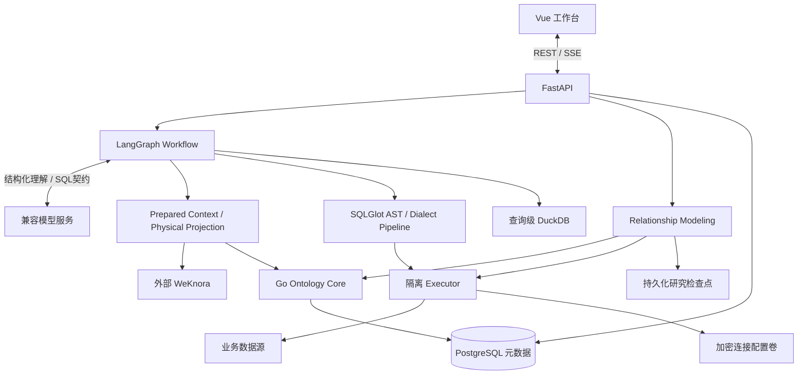

# Semora 系统与 Agent 架构

> 当前架构，2026-11-16 核对。本文替代早期 Conversation Owner / Analyst / Reviewer 三岗位与独立 Semantic Planner 的运行时描述。

## 1. 架构定位

Semora 是以领域本体为语义支点的自然语言数据分析系统。整体采用 **Control Plane / Execution Plane** 分离：API 与 Ontology Core 管理需求契约、元数据、关系及任务状态，Executor 持有连接配置并执行只读数据库操作。模型负责语义判断与 SQL 构造；程序负责作用域、协议、预算、映射和执行边界。

Agentic 能力体现在按需调用资料工具、解释关联语义和基于具体诊断修复 SQL。LangGraph 是持久化工作流运行时，状态节点不被等同于独立 Agent；数据库访问、快照组合、参数绑定、资源限制及状态提交均有确定性的实现边界。

## 2. 运行拓扑

五类常驻服务为 Web、API、Ontology、Executor、PostgreSQL。三个一次性迁移任务建立 API 元数据、LangGraph 状态和本体 schema，不承担演示数据初始化的常驻职责。

## 3. 元数据与语义资产

### 3.1 结构快照与建模输入

数据库扫描采集版本、表列、注释、索引与约束。原始结构与用于关系研究的精简输入分开保存；精简结构过滤明显不适合引用的类型，同时保留主外键等结构性例外。

完整扫描成功后才提交表集合变更。扫描失败或中途断连不等于源表被删除；新扫描只更新结构，用户显式启动关联重分析后才进入关系生成管线。

### 3.2 本体组合与查询快照

业务域配置由数据源包引用、域内跨源关系及自定义配置组成。单源关系维护在数据源侧，本体服务负责形成当前可查询的有效配置；跨源关系与具体业务域绑定。

配置保存和生效定义校验在服务端完成，发布过程保留内容哈希与快照。新查询绑定最新有效配置；进行中的查询维持原绑定，避免分析与执行期间混用不同映射。快照属于内部一致性机制，用户无需手工维护本体版本号。

关系管理保留已生效、待审核和已停用状态。复合键、引用角色、条件限定和人工干预都参与完整关系语义，不能只按表对或单字段名称去重。

## 4. 关联发现：检索召回与有界研究

- **Retrieval Consistency**：提取与召回使用一致的资料范围，忽略大小写与空白；非法词按项丢弃并记录诊断，不因单个异常词重跑完整批次。
- **Semantic Grouping**：先召回候选资料，再由模型整理语义组。整理后的组独立调度，不将组间两两笛卡尔比较作为后续固定流程。
- **Bounded Exploration**：详细资料按请求预算装载，资料工具避免重复堆叠；模型探索有步数与调用预算，并有结论交付阶段。
- **Durable Progress**：阶段结果保存在工作记录与检查点中；恢复以已完成工作为基础，不把工具或模型技术错误伪装成“没有关系”。
- **Evidence-aware Publication**：命名、注释、表职责、约束和数据证据共同参与判断。共同引用第三方实体不自动证明两张明细表之间存在直接引用；模型意见也不替代数据事实。

共享模型并发默认值为 3。关系数量不被固定候选上限截断，但实际覆盖仍受输入质量、召回效果、模型判断和资源预算影响；终态会区分完整完成与技术未完成。

## 5. 查询：语义理解与物理执行解耦

### 5.1 需求契约

原始需求、用户确认事实与模型理解分别保留。理解阶段明确最小必要对象、每行含义、指标来源、筛选、时间、排序及数量；只有影响结果且无法由现有资料判断的业务歧义才生成澄清卡片。

资料上下文按需选表，已选表提供完整本体字段。目录与知识工具用于补齐核心信息，不将全库完整 Schema 默认装载到每次请求。

### 5.2 SQL 模型视图

需求分析可使用本体内部标识。SQL 生成、语义对照及修复使用单独的 **Physical-name Projection**：

1. 对象和属性引用转换为真实物理表列；逻辑引用携带必要的数据源归属。
2. 主键、关联端点和完整条件同步映射；表达式通过 AST 转换，保留字面量与业务编码。
3. 移除 SQL 阶段不再需要的内部名称及广域对象候选目录。
4. 合并重复的本体和扫描属性，以列定义和数据行编码重复 JSON 对象；只有压缩后更小时才采用紧凑格式。

原始本体、运行快照和内部校验输入不被上述投影覆盖。程序仍可识别模型误用已知内部列标识，并返回具体物理映射；合法 CTE、派生表和结果别名不会因名称相似而被替换。

### 5.3 SQLProgram 与异构执行

模型输出 PostgreSQL 基准 SQL 与结构化步骤契约。source 步骤限定数据源与物理表；local 步骤只读取前置结果。跨源筛选通过完整键元组绑定，复合键不拆成相互独立的值集合。

SQLGlot 负责只读与作用域分析、分组检查、连接放大风险检查、绑定参数及方言转换。目标数据库 EXPLAIN 与实际只读执行验证可执行性；复杂语义另有有界对照，简单投影不强制增加一次审核请求。

具体 SQL 错误可进入整单预算内的定向修复，修复后的 SQL 经过同样检查；认证、权限和网络错误保持其错误分类。重复无效提交会结束处理，不靠无限重试掩盖失败。

### 5.4 中间结果与最终交付

跨源中间结果在单次查询的内存 DuckDB 中计算，限制外部访问、内存、线程与执行时间。截断的中间集合不能被当作完整集合参与后续计算；最终截断会明确标记。

返回数据、SQL 和执行记录作为独立交付物。结果超过 100 条时跳过模型结果说明；100 条及以内的说明只应基于返回资料，不把 Top N 或抽样结果推断为全库结论。

## 6. 持久化与观测

| 状态域 | 持久化机制 | 运行约束 |
|---|---|---|
| 会话与查询 Run | PostgreSQL JSON 与事件记录 | 保存需求、产物、结果、错误分类与关联标识 |
| 澄清及查询状态图 | LangGraph PostgreSQL Checkpointer | 支持持久化中断、恢复和取消语义 |
| 结构与研究输入 | 数据源元数据与精简输入表 | 以输入指纹识别变更 |
| 关联研究 | 数据库工作记录与持久化检查点目录 | 复用已完成工作，保留未完成原因 |
| 生效本体 | Ontology 配置、源包与内容快照 | 新旧查询各自绑定完整配置 |
| 数据库凭据 | Executor 加密配置卷 | 不作为模型上下文或普通元数据明文 |

SSE 提供增量事件和断点游标；模型诊断关联 Run、Trace、HTTP 请求轮次、请求大小、耗时及响应状态。公开输入输出调试按配置启用，不将隐藏推理正文作为诊断资产。

## 7. 部署与验证边界

默认维护 Docker Compose 部署，可选 Cython 原生扩展交付。编译交付降低源码直接分发程度，不等于运行时字符串加密或不可逆向。

回归测试覆盖结构协议、关系研究、SQL 映射、查询执行、恢复和页面交互。真实实例验收与合成夹具测试分别记录；驱动存在、语法解析通过或一次成功执行均不等同于全面兼容和业务正确性证明。

入口与当前使用方式见 [README](../../README.md)，细节见 [SQL 查询链路](../sql-generation-mvp.md)、[关联分析](../relationship-discovery.md)及[上下文工程](../query-context-compaction.md)。
