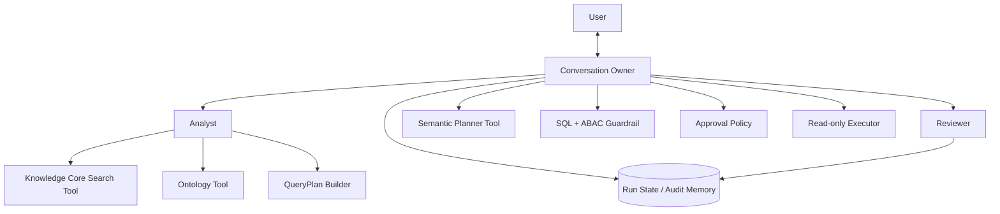

# Semora Agentic Architecture

## 架构结论

Semora 只有三个岗位级 Agent：Conversation Owner、Analyst 和 Reviewer。Conversation Owner 是唯一会话 Owner；Analyst 与 Reviewer 只返回结构化结果，互不调用。检索、本体、语义规划、SQL 门禁、审批、执行和审计全部是确定性 Tool/Policy/Code。

## Agent contracts

| Agent | Goal | Input | Output | Forbidden |
|---|---|---|---|---|
| Conversation Owner | 根据目标和状态决定下一步并形成最终答复 | Goal、Run State、事件 | 下一动作、最终说明 | 执行 SQL、修改策略、发布本体 |
| Analyst | 生成有证据和本体约束的 QueryPlan | 问题、证据、本体快照、数据范围 | QueryPlan 或澄清请求 | 回复用户、执行、审批、调用 Reviewer |
| Reviewer | 隔离复核证据、计划、SQL、门禁和结果 | 不含 Analyst 私有上下文的审查包 | approved/revise/rejected | 回复用户、执行、替代人工审批、调用 Analyst |

依赖边只有 `Owner → Analyst` 与 `Owner → Reviewer`；循环依赖、多 Owner、固定 Intent Router 均不存在。审批和安全规则不由 LLM 决定。

## 反 DAG 检查

- 没有把流程状态节点命名为 Agent。
- Knowledge Core 检索是 Tool，不是知识库 Agent。
- SQL 门禁和审批是 Policy，不是 Agent。
- Reviewer 按风险和状态调用，不是每条消息必经的固定聊天链。
- 状态是可审计业务事实；状态推进来自 Tool Result 和 Policy Decision。

Agentic Score：94/100。

