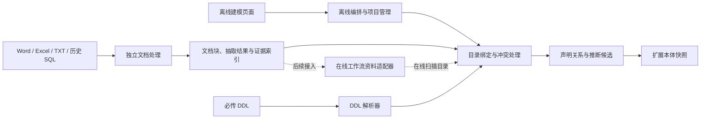

# 离线建模扩展架构与模块设计

适用基线为 Semora 提交 `835749e`，分支 `feature/multi-database-test-modes`。本文描述待开发方案。

## 产品范围

| 使用方式 | 目录来源 | 本期产出 |
| --- | --- | --- |
| DDL + 可选文档 | 显式指定方言解析必传的 DDL，按需绑定零份或多份文档 | 固定的离线表目录和可维护的关联关系 |
| 数据库连接 + 文档 | 在线扫描目录 + 同一文档服务抽取的事实 | 后续接入阶段 |

入口建议为数据源页面「添加数据源」旁的「导入离线数据源」，打开扩展页面。一个建模项目对应一个目标数据库，必须提供一份可解析的 DDL，可以附多份资料。文档可以独立进入资料库做抽取和索引，建模时再绑定到 DDL 目录。未启用扩展时隐藏入口，独立 URL 也可直接使用。

## 部署与依赖

在 `extensions/offline-modeling/` 下集中放后端、前端、迁移、测试与独立 Compose 配置。首版一个扩展服务部署，代码内将文档处理、目录绑定和离线编排分包。文档模块允许以后独立部署。

| 模块 | 职责 | 依赖 |
| --- | --- | --- |
| `documents` | 读取、分块、提取、索引、按位置回读 | 文件解析器、模型接口、扩展存储 |
| `ddl` | 按指定方言提取结构、约束和视图定义 | SQL 解析器 |
| `catalog` | 接收目录、绑定事实、处理冲突、生成固定快照 | 标准目录及文档事实契约 |
| `modeling` | 声明关系发布、关联补充分析、待确认管理 | 目录快照、证据查询接口 |
| `api / frontend` | 项目、导入、预览、关系、本体及查询入口 | 扩展服务接口 |

**首版的本体由扩展独立保存与发布。** 当前主系统的本体配置入口检查连接健康和只读状态，跨源启动也检查连接状态。Ontology Core 的数据源包接口绑定正式数据源 ID 和表结构哈希。基于这些约束，首版在扩展内完成发布，提供可导出的本体与证据包。跨服务发布到主系统本体属于后续集成，通过公开契约和专门适配器实现。参考 [主系统本体保存入口](../../services/api/app/main.py#L716)、[跨源启动](../../services/api/app/datasource_modeling.py#L1864)、[Ontology Core 数据源包更新](../../services/ontology/cmd/server/source_packages.go#L401)。

原系统的在线核心、Executor、能力缓存与本体存储保持原有职责。扩展可引用通用契约和独立模型客户端，采用自己的 Agent 编排。停用时撤掉入口和独立服务。扩展数据可先导出，再按保留策略清理自己的库或卷。

## 事实融合与生效策略

DDL 解析与在线扫描都产出标准表目录。区别在于扫描读取数据库元数据，DDL 在文件中恢复对象定义，可信度分别记录为实例观测与文件声明。目录包含物理表标识、字段及类型、注释、主外键、索引和解析状态。两种目录进入同一套绑定与关联分析输入契约。

大型 DDL 先按方言识别完整语句，再把 `CREATE TABLE`、后续 `ALTER TABLE`、索引和注释组装到所属表。全文件读完后解析跨表引用并发布目录。模型按组装后的表资料分批分析，超宽表只在模型输入层分片。

1. **来源与身份。** 使用项目、Catalog、Schema、物理表名、物理字段名识别对象，按目标方言保留引号与大小写语义。中文名和业务名用于寻找候选映射。每项事实保留文件版本、原文位置及抽取依据。
2. **采纳规则。** 离线项目以 DDL 为物理结构基准，未来在线接入以扫描目录为基准。文档补充业务语义、码值和关系。文档引用的表字段缺失时，记录映射缺口，由用户补齐 DDL 或校正映射。来源冲突进入预览，用户解决映射或选择可信版本。导入确认后，DDL、文档、抽取证据、数据库配置和物理目录冻结。新版本资料通过创建新的虚拟数据源导入。关系可独立新增、编辑、确认、停用或恢复，保留来源和修改记录。
3. **声明关系。** DDL 外键、客户明确规定的关系，在两端字段可定位、映射及条件完整、无冲突时直接生效。保留复合字段顺序与角色。基数按明确声明或约束推导，未知时保留未知，查询编排对依赖基数的聚合使用保守策略。文件声明和数据库物理外键分别记录来源。
4. **历史查询。** 保存原需求、SQL、目标方言线索、指标、过滤、粒度及可追溯的物理 JOIN。历史 JOIN 保留场景和条件。完整物理字段映射通过校验后，基数明确的关系直接生效，基数未知的进入待确认。CTE、临时表及聚合结果间的连接保存在查询案例中，能追溯到物理字段时才形成关系线索。
5. **补充发现。** Agent 以精简目录、声明关系和按需证据进行召回、分组及分析。按完整映射、角色与条件识别已声明关系，其余候选继续发现。离线推断进入待确认，分析任务正常结束。在线接入后，推断关系继续走现有语义与取证规则。

数据库产品、版本、兼容模式和默认 Catalog/Schema 作为项目配置。版本可未知，解析 DDL 时需要明确方言。文档线索可推荐配置，配置来源区分用户声明与在线观察。本期范围止于离线导入、目录查看和关联关系管理。
