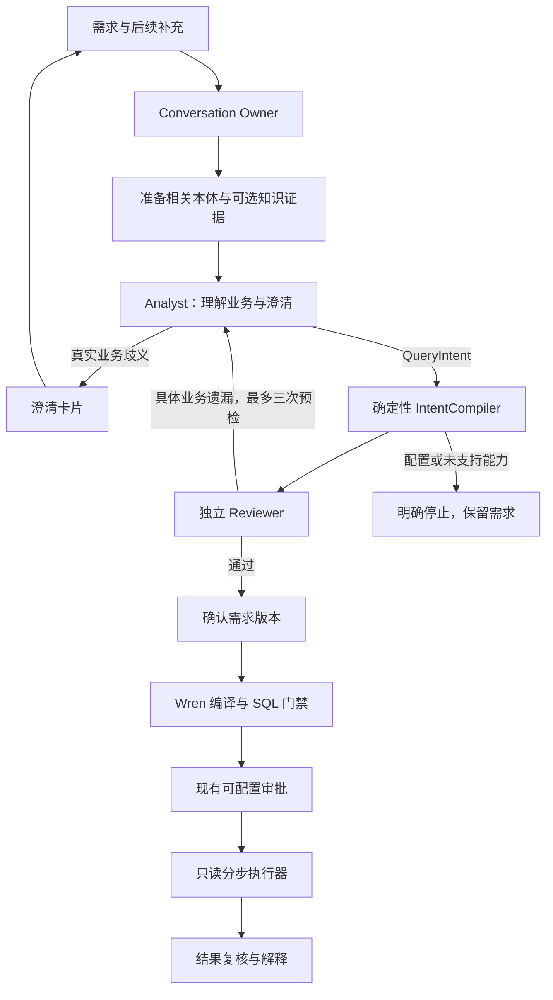

# 业务意图与程序规划

默认启用 `AGENT_QUERY_INTENT=true`。旧的模型填写 QueryPlan 协议仅在显式关闭该开关时用于兼容；历史需求与审计仍可读取。

## 职责与上下文

- Analyst 只提交 QueryIntent：主体、业务字段、最终分组、指标、必要过滤、选取对象/时间/数量、范围与排序。不能提交 SQL、source_steps、stages、数据源 ID 或关联键。
- 不再在 Analyst 前额外运行一遍选取键/技术方案的“信息充足性推理”；业务是否明确由同一次 Analyst 判断。上下文服务只准备相关资料。
- 程序根据已发布对象分配数据源，解析完整等值关联键，生成局部关联及分步传键。不同业务角色的关系路径不唯一时返回业务歧义，不能选最短路径猜测。
- 一对多的独立明细指标由程序生成预聚合；仍由既有 QueryStages 验证关联放大、字段与粒度。不能证明安全的计算明确停止。
- Reviewer 收到业务意图及独立编译的执行方案，不读取 Analyst 私有历史。不再让 Analyst 修补物理执行步骤；只允许修正真实业务含义。
- QueryIntent 存入 QueryPlan、RequirementDraft、不可变 RequirementSpec，纳入既有需求哈希、审批与审计绑定。新一轮任务通过意图和用户确认口径继承语义，重新编译和复核。
- Analyst 上下文去除物理表、列、SQL、执行步骤、传键模板和阶段键。旧会话仍完整保留各业务操作的筛选、排序、数量、指标定义，避免续聊丢失范围。

## 已支持的程序规划

- 单源明细、发布指标及受限聚合；自动选择对象真实数据源。
- 有明确角色的树形关联；多条合理角色路径要求澄清。
- 链式跨源只读半连接；复合键按完整元组传递，沿用最多 1,000 组限制。
- 先取记录/不同实体 Top N，再取关联记录；选取排序与最终排序独立。
- 同源先选再汇总通过已发布主键半连接，不创建数据库对象。
- 选取时段、全部关联历史、仅所选记录分别表达，程序不擅自继承选取筛选。
- 按完整前置主键分组的属性可在目标键汇总后补齐，运行时继续核验键唯一性。
- 独立多端的简单聚合预归并；加权平均使用现有 QueryStages 编译能力。

## 明确边界

当前不是任意联邦 SQL 引擎。跨源多个事实的联合汇总、任意外部维度再分组、复杂多层聚合、无法证明等价的空值外关联变换等会明确停止，不能偷偷改变统计粒度。既有只读门禁、机构权限、敏感字段配置、审批和结果限制继续生效。

旧协议测试显式使用 `AGENT_QUERY_INTENT=false`，新协议测试验证生产默认开启、严格意图契约、编译、真实 SQLite 只读执行、哈希审计及新旧记忆衔接。浏览器验收与实际部署记录在本地 artifacts/source-planning 中。

## 2026-11-06 验收

- API：373 项，372 通过，1 项因未配置独立元数据测试数据库跳过。
- Linux 真实 Wren 适配器：9 项通过。
- 浏览器与真实模型、Wren、只读 Executor：先选 10 条记录，跨库汇总得到 8 条匹配结果；续聊仅将数量改成 5 条，得到 3 条匹配结果。两次 Analyst 均只请求模型一次，调用 validate_intent；预检、执行前和结果 Reviewer 均通过。
- 程序对比两次完整执行方案：除选取 limit 外保持一致；前置字段由 Executor 补齐，实际返回的约课标识与传入标识一致。审计哈希链均有效。
- 验收发现并修复：前置重复分析误选字段、选取时间说明泄漏到后续步骤、Reviewer 误判 Executor 补齐列。技术编译错误不会再转交业务 Analyst 反复改写。
- 本地证据：artifacts/source-planning/query-intent-acceptance.json、tests-query-intent.xml、tests-planner-intent.xml。测试未读取或发送文本正文。

后续P1语义修复和首个职责提取的结果、399项回归及真实Wren合成用例见[增量实施记录](correctness-and-boundary-migration.md)。该批保持原服务数量与权限限制。

第二批已完成独立QueryCore、候选与任务契约、角色模块及持久复核/执行控制状态拆分，见[第二批实施记录](second-batch-implementation.md)。最新回归为415项通过、1项跳过，真实Wren10项通过，部署后六个合成编译场景与原有SQL哈希一致。
