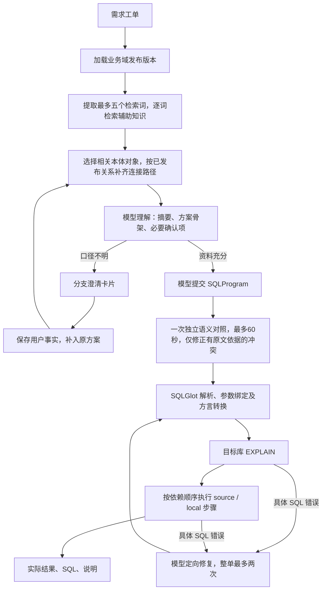

# SQL 查询链路与维护边界

## 唯一运行路径



模型生成 PostgreSQL 基准方言 SQL，SQLGlot 转为目标方言；数据库 EXPLAIN 和实际执行验证可执行性。语法正确不等于业务含义已获证明。当前支持 MySQL、PostgreSQL；其他数据库需增加并验证连接、参数、方言及预校验适配器，不能仅凭 SQLGlot 支持该方言就宣布完整支持。

理解角色调用资料工具，产出 `QueryUnderstanding`；SQL 角色依据原始需求、实际确认答案、相关定义、表结构、身份键和数据库版本，产出 `SQLProgram`，不继承未确认草案的结论。结构由 Pydantic JSON Schema 随请求提供。二者使用独立请求上下文，不累积原始 HTTP 记录；提示词在 `semora_agent/sql_prompts.py`，通用研究及协议提示词在 `semora_agent/prompts.py`。

涉及聚合、关联或多步骤的 SQL 增加一次独立对照请求，仅接收原始需求、确认答案、精简映射和 SQL，不读取前一角色的结论及原始知识全文，不调用工具。只允许修改已有步骤的 SQL 和参数，不能新增数据源、步骤或更换输出契约，修正仍经过相同契约与数据库校验。没有确定冲突时保持原方案；核对服务不可用时提示警告并继续原 SQL 的数据库校验与执行，不启动循环协商。核对有助于减少语义偏差，不构成正确性证明。

`SQLProgram` 是 SQL 与依赖的契约，不是自研关系代数：每步声明名称、目的、执行引擎、SQL、绑定参数、输出列和来自先前步骤的输入键。程序检查契约、传参和作用域，不重建 SQL 的聚合与关联语义。

## 模块边界

- `Workflow` 只协调生命周期。LangGraph 保留稳定节点名，持久化澄清中断可恢复；没有第二套旧编译器回退。
- `RequirementAlignment.run` 控制澄清顺序；独立方法负责答案持久化、按已提交草稿复用分析、继续分析与确认定稿。分支隐藏答案不会进入确认事实；自由输入仍进入模型理解。答案先保存再分析，重放已完成的澄清分析不新增一轮模型请求。
- 本体发布只验证定义完整性和物理映射，不生成 Wren MDL，不用 Wren 投影能力约束本体；关系寻路直接使用本体关系。历史快照保留原内容、版本及产物，不在迁移时重算。数据库遗留 `wren_artifact` 列仅作兼容，新快照写空对象。
- `RequirementAlignment` 保存卡片答案及语义，最多先确认需求方向、再集中确认业务口径。图重放不是新一轮问询。
- `prepared_context` 先逐词检索知识，再以轻量对象/身份键目录、关系目录及最多48条匹配字段提示选取相关对象；已选对象连通时不引入其他桥接对象。答案变化后按统一版本绑定刷新资料，补充工具使用同一绑定。
- `ResearchTools` 管理资料访问与共享准备包；新阅读的 Wiki 内容会进入后续 SQL 角色的资料包，来源保留在状态中。
- `SQLExecution` 保持已成功步骤的实际结果；修复失败步骤不会重跑前置查询。`ExecutorClient` 负责业务源网络请求，`result_engine` 负责内存结果计算。
- `Store` 和 `control_state` 只持久化查询记录及读取历史形状。历史旧计划可展示，不能作为新查询执行方案。

## 执行约束

source 步骤只引用该源本体中的物理表；local 步骤只引用先前步骤的实际结果。完整键元组按参数传递，NULL 等值键不参与匹配，空集合编译为 FALSE。复合键不能拆成独立 IN 集合。

DuckDB 每次创建独立内存库，关闭外部访问，单线程、256MB 内存及查询超时。类型随结果传递；DECIMAL 按字符串传输后恢复数值类型。截断中间结果不能参与后续完整集合计算；最终结果截断明确提示。

SQL 格式问题最多一次契约纠正。语法、字段、类型和函数错误允许定向 SQL 修复，整次运行共两次；连接、认证和权限错误不靠改 SQL 重试。EXPLAIN 能力明确不可用时标注警告，通过实际只读执行验证；其他数据库错误保留具体诊断。零行是正常结果，不擅自放宽条件。

已扫描的数据库版本参与资料绑定和生成上下文；已知不支持的窗口函数或 WITH 在提交时要求改写，未知版本不猜测禁用。MySQL 聚合排序别名在生成 NULL 排序表达式前按 SELECT 作用域展开，不删除 NULL 排序语义。明确的裸列分组错误和会话变量赋值在基准 SQL 校验时反馈修复。

活跃路径没有 Reviewer Agent、审批、成本门禁或审计账本。SELECT 只读、超时、行数和大小限制仍是执行器的资源边界。数据库升级与历史 JSON 展示兼容不是旧业务逻辑回退。退休表的删除通过明确迁移执行并提前备份；测试数据清理限定于已确认范围，不自动清空用户查询历史或外部业务数据。

## 验证与日志

`services/api/tests` 只验证当前路径及仍在使用的通用组件，不通过环境开关重新启用旧规划器。新增数据库或执行能力需补适配器测试；跨源变更需验证完整键、空集合、截断、精确数值和前置结果复用。

`SEMORA_DEBUG_PAYLOADS=true` 时，API Docker 日志按 run_id / http_round / request_id 记录模型公开输入输出、工具调用和 SQL 参数。模型隐藏推理正文和连接密钥不记录。日志不进入模型上下文。查看：

```powershell
docker compose -f docker-compose.yml -f deploy/compose.mvp.yml logs -f api executor
```
